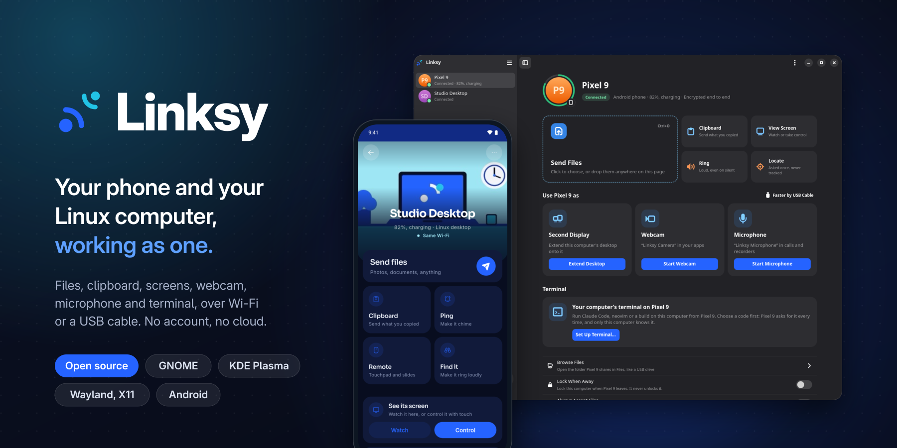

  The public face of Linksy on GitHub: the organisation profile and its shared files.
    

**[Organisation page](https://github.com/LinkSy-mg)** &nbsp;·&nbsp; **[Download](https://github.com/LinkSy-mg/linksy-releases)** &nbsp;·&nbsp; **[Website](https://linksy.diary.mg)** &nbsp;·&nbsp; **[Roadmap](https://github.com/orgs/LinkSy-mg/projects/1)**

---

## What's in here

| Path | What it does |
| --- | --- |
| [`profile/README.md`](profile/README.md) | The page visitors see on [github.com/LinkSy-mg](https://github.com/LinkSy-mg) |
| [`profile/banner.png`](profile/banner.png) | Its banner |

---

## Linksy in short

Linksy connects your Android phone and your Linux computer: files, notifications, the
clipboard, media controls, the phone's camera and microphone in your apps, a second
display, and your computer's screen and terminal on the phone. Devices talk directly,
end-to-end encrypted, with no account and no cloud.

| | Where |
| --- | --- |
| Website | [linksy.diary.mg](https://linksy.diary.mg) |
| Download | [linksy.diary.mg/#download](https://linksy.diary.mg/#download) · [all releases](https://github.com/LinkSy-mg/linksy-releases/releases) |
| Roadmap | [Project board](https://github.com/orgs/LinkSy-mg/projects/1) |
| Source | [linksy-desktop](https://github.com/LinkSy-mg/linksy-desktop) · [linksy-mobile](https://github.com/LinkSy-mg/linksy-mobile) · [linksy-server](https://github.com/LinkSy-mg/linksy-server) |

---

## Get involved

- **Found a bug or want a feature?** Open an issue on
  [linksy-releases](https://github.com/LinkSy-mg/linksy-releases/issues).
- **Want to contribute?** The Linux app lives in
  [linksy-desktop](https://github.com/LinkSy-mg/linksy-desktop).

## Licence

The Linux app is open source under the
[GNU AGPL v3.0 or later](https://github.com/LinkSy-mg/linksy-desktop/blob/main/LICENSE).

---

  Built in <b>Antananarivo, Madagascar</b> by <a href="https://diary.mg"><b>Axel RAKOTOARIVAO</b></a> 
  <a href="https://diary.mg">Portfolio</a> · <a href="https://github.com/Dokja620">GitHub</a>

