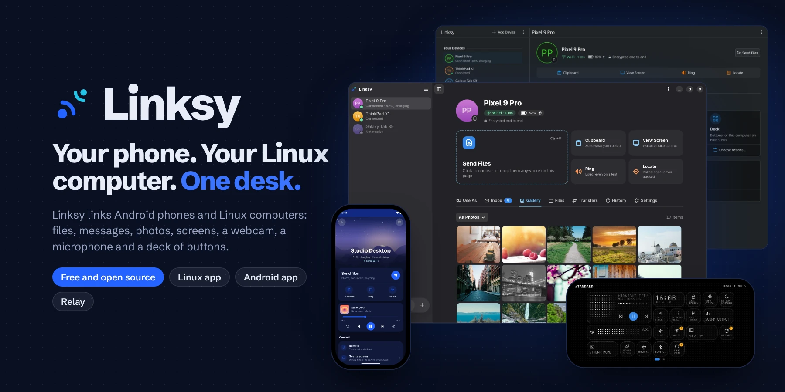

  Files, clipboard, screens, webcam, microphone and terminal between your Android phone and your Linux computer. Directly, end to end encrypted, with no account and no cloud.
    

  
  
  
   
  
  
  

**[Download](https://github.com/LinkSy-mg/linksy-releases)** &nbsp;·&nbsp; **[Website](https://linksy.diary.mg)** &nbsp;·&nbsp; **[Roadmap](https://github.com/orgs/LinkSy-mg/projects/1)** &nbsp;·&nbsp; **[Report a problem](https://github.com/LinkSy-mg/linksy-releases/issues)**

---

## Why Linksy

- **Your phone on your computer.** Files, notifications, the clipboard, media
  controls, the phone's camera and microphone in your apps, a tablet or phone as a second
  display, and the computer's screen and terminal on the phone.
- **Private by design.** Devices talk to each other directly, end-to-end encrypted. No
  account, no cloud, no tracking in the app.
- **Made for Linux.** Native apps that fit your desktop, not a port: GTK for GNOME and most
  desktops, Qt for KDE Plasma. X11 desktops, Hyprland, Sway and niri work too.
- **Open source and free.**

---

## Repositories

| Repository | What it is |
|---|---|
| [linksy-releases](https://github.com/LinkSy-mg/linksy-releases) | **Start here:** downloads for Android and Linux, and bug reports |
| [linksy-desktop](https://github.com/LinkSy-mg/linksy-desktop) | The Linux apps (GTK and Qt) and their background service |
| [linksy-mobile](https://github.com/LinkSy-mg/linksy-mobile) | The Android app |
| [linksy-server](https://github.com/LinkSy-mg/linksy-server) | Linksy Relay, for reaching your devices away from home |

---

## Built with

---

## How it's made

Linksy is built by one developer. [Claude](https://claude.com/claude-code) is the main tool
I code with, alongside me.

## License

The Linux app is open source under the
[GNU AGPL v3.0 or later](https://github.com/LinkSy-mg/linksy-desktop/blob/main/LICENSE).

---

  Built in <b>Antananarivo, Madagascar</b> by <a href="https://diary.mg"><b>Axel RAKOTOARIVAO</b></a> 
  <a href="https://diary.mg">Portfolio</a> · <a href="https://github.com/Dokja620">GitHub</a>

